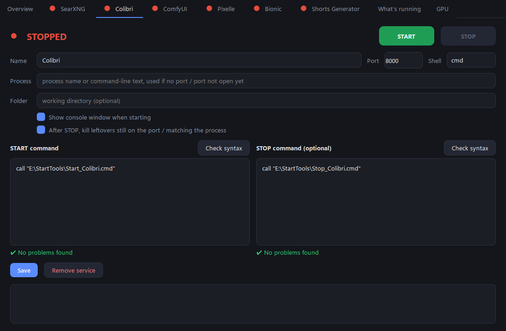
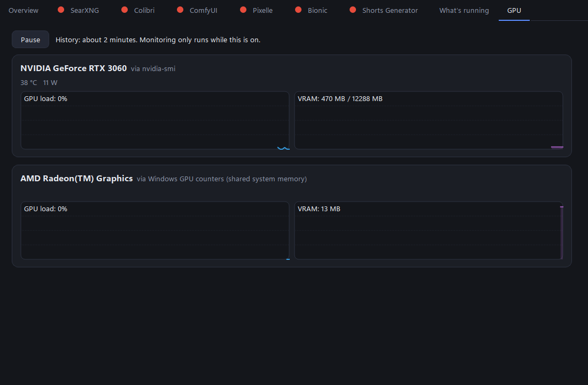

# Service Panel

A small Windows desktop app to start, stop and watch the local services you keep juggling
(AI servers, web UIs, background tools), from one window instead of a folder of `.bat` files.



## Features

- **One tab per service** with big START / STOP buttons and a live status:
  green = running, amber = process is up but the port isn't open yet, red = stopped.
- **Editable start and stop commands**, run as `cmd` or PowerShell.
- **Syntax check as you type.** PowerShell is checked with the real PowerShell parser.
  CMD has no parser, so it uses heuristics: unbalanced quotes/parentheses, missing `goto`/`call`
  labels, `if`/`for` problems, unknown commands, paths that don't exist.
- **Status by port**, with a process-name / command-line match as fallback for services without a port.
- **STOP that really stops**: runs your stop command, then (optionally) kills anything still holding
  the port or matching the process.
- **What's running**: every listening TCP port with its process and command line.
  One click on *Add as service* turns it into a tab, or kill it.
- **GPU monitor** with live load and VRAM graphs:
  - NVIDIA via `nvidia-smi` (also temperature and power)
  - AMD via `amd-smi` when installed (see note below)
  - anything else (AMD, Intel) via the built-in Windows GPU counters, no install needed



## Run it

**[Download ServicePanel.exe](https://github.com/SnyderMining/service-panel/releases/latest)** (Windows may show a SmartScreen warning because the exe is unsigned; the source is here to check or build yourself), or run from source:

```bash
python -m venv .venv
.venv\Scripts\pip install -r requirements.txt
.venv\Scripts\python app.py
```

Build the exe yourself with `build.bat` (PyInstaller, output in `dist\`).

Your services are saved to `services.json` next to the exe/script (it is git-ignored).
A fresh install starts empty: click **+ Add service**, or open **What's running** and add one
from a running process.

## Notes

- **AMD:** the `amd-smi` reader is written against the documented `amd-smi metric --json` /
  `static --json` output and tested against sample output, but not yet on real AMD hardware.
  If the numbers look wrong on your card, please [open an issue](https://github.com/SnyderMining/service-panel/issues/new?template=gpu-report.md) with the output of
  `amd-smi metric --json`. Without `amd-smi` it falls back to Windows counters automatically.
- If a service runs as administrator, run Service Panel as administrator too, otherwise STOP
  cannot kill it.
- The GPU monitor only runs while the GPU tab has been opened, and stops when the app closes.
- Windows only.

## Layout

| File | Purpose |
|---|---|
| `app.py` | Qt window, tabs |
| `runner.py` | start / stop / status / port scan |
| `checker.py` | command syntax checks |
| `gpu.py` | GPU monitor and graphs |
| `config.py` | `services.json` load/save |
| `theme.py` | dark theme |

MIT licensed.
